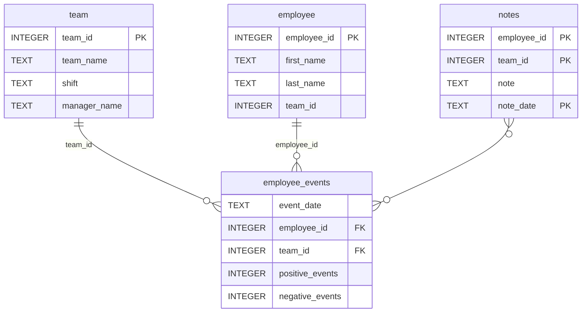

#  Employees' performance Dashboard
___

This project implements simple employees' performance dashboard. It contains below metrics that are defined on employee and team level:
- cumulative sum of positive and negative notes collected by managers
- list of notes
- probability of employee/team being hired by another company

This project was created as part of Project #2 for [Udacity Data Scientist Nanodegree Program](https://www.udacity.com/course/data-scientist-nanodegree--nd025)

## Installation

### Requirements

- Python 3
- Git

1. Clone repository into your local machine:
 ```bash
git clone https://github.com/karolcymerys/udacity-data-science-dashboard.git 
```

2. Go into root of the project:
```bash
cd ./udacity-data-science-dashboard
```

3. Create new virtual environment (optional):
```bash
python -m venv .venv 
```

4. Install required:
```bash
pip install -r requirements.txt 
```

5. Run dashboard
```bash
python report/dashboard.py
```

Application is available at URL: `http://localhost:5000`.

## Repository Structure

```
udacity-data-science-dashboard/
├── README.md
├── assets
│   ├── model.pkl
│   └── report.css
├── env
├── python-package
│   ├── employee_events
│   │   ├── __init__.py
│   │   ├── employee.py
│   │   ├── employee_events.db
│   │   ├── query_base.py
│   │   ├── sql_execution.py
│   │   └── team.py
│   ├── requirements.txt
│   ├── setup.py
├── report
│   ├── base_components
│   │   ├── __init__.py
│   │   ├── base_component.py
│   │   ├── data_table.py
│   │   ├── dropdown.py
│   │   ├── matplotlib_viz.py
│   │   └── radio.py
│   ├── combined_components
│   │   ├── __init__.py
│   │   ├── combined_component.py
│   │   └── form_group.py
│   ├── dashboard.py
│   └── utils.py
├── requirements.txt
├── start
├── tests
    └── test_employee_events.py
```

## Entity Relationship Diagram

### employee_events.db


